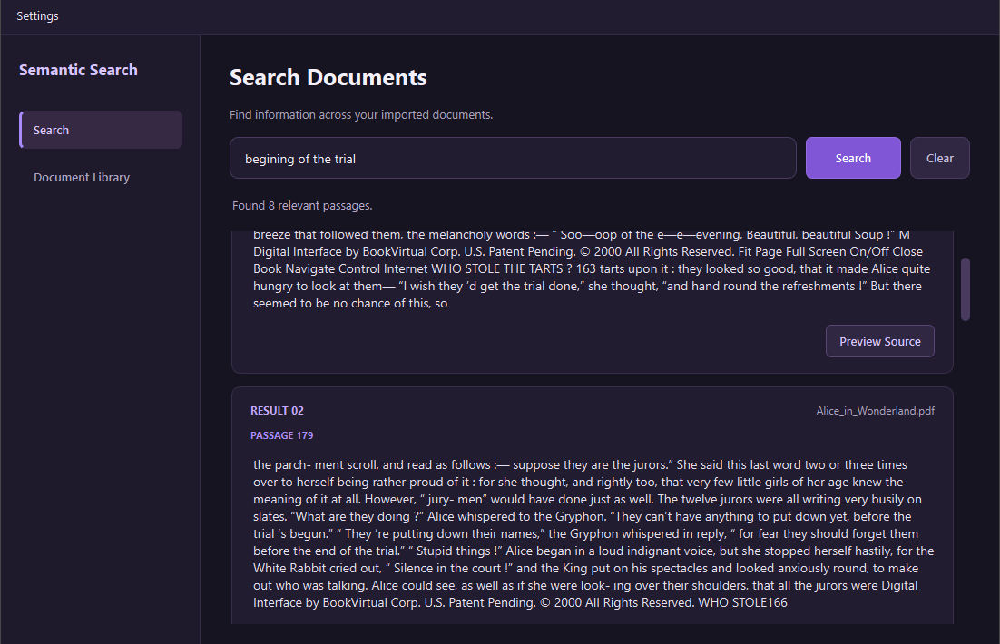

# Semantic Search Engine

**A privacy-focused, AI-powered desktop application for finding information across your documents using natural language.**

Semantic Search is a local desktop application that goes beyond traditional keyword matching. It combines transformer-based semantic embeddings, BM25 keyword retrieval, hybrid ranking, and cross-encoder reranking to find relevant passages based on both meaning and textual relevance.

Built with Python and PySide6, the application provides a clean desktop interface for importing, organizing, and searching personal documents without relying on a cloud-hosted search service.

<!-- Replace this with a screenshot of the application -->
<p align="center">
  
</p>

<p align="center">
  <strong>Search by meaning. Find the information that matters.</strong>
</p>

---

## ✨ Features

- **Semantic Search** — Find relevant passages even when your query uses different wording from the original document.
- **Hybrid Retrieval** — Combine semantic similarity with traditional BM25 keyword search.
- **Intelligent Reranking** — Use a cross-encoder model to refine candidate results based on query-passage relevance.
- **Multiple Document Formats** — Import and search PDF, Markdown, and plain-text documents.
- **Passage-Level Results** — See the specific passages relevant to your search instead of only receiving document-level matches.
- **Source Preview** — Open the original document and navigate directly to the matching passage.
- **Persistent Indexing** — Store document chunks and FAISS indexes locally, avoiding unnecessary reconstruction between sessions.
- **Local-First Architecture** — Documents, indexes, and application settings are stored locally.

## 🧠 How It Works

Traditional search engines primarily rely on matching words and terms. This can become limiting when someone searches for a concept using terminology that differs from the source material.

Semantic Search addresses this by combining multiple retrieval techniques into a single search pipeline.

### Search Pipeline

```text
flowchart TD
    A["User Search Query"] --> B["Semantic Retrieval"]
    A --> C["BM25 Keyword Retrieval"]

    B --> D["FAISS Vector Index"]
    C --> E["BM25 Index"]

    D --> F["Reciprocal Rank Fusion"]
    E --> F

    F --> G["Candidate Passages"]
    G --> H["Cross-Encoder Reranking"]
    H --> I["Ranked Search Results"]
    I --> J["Source Preview"]
```

## 🛠️ Technology Stack

| Technology | Purpose |
|---|---|
| Python 3.11 | Core application language |
| PySide6 | Desktop GUI and application interface |
| Sentence Transformers | Semantic embedding generation |
| FAISS | Vector indexing and similarity retrieval |
| BM25 / rank-bm25 | Keyword-based information retrieval |
| Cross-Encoder | Candidate relevance reranking |
| NumPy | Numerical operations and embedding handling |
| PyPDF | PDF text extraction |
| PyInstaller | Windows executable packaging |

---

## 🏗️ Architecture

The application follows a modular architecture that separates the desktop interface, document processing, search logic, and persistent storage.

### Core Components

| Component | Responsibility |
|---|---|
| `document_loader.py` | Imports documents, extracts text, detects duplicates, and manages the document library. |
| `text_chunker.py` | Splits document text into overlapping passages for indexing and retrieval. |
| `search_engine.py` | Implements semantic retrieval, BM25, hybrid ranking, and cross-encoder reranking. |
| `index_manager.py` | Saves and loads persistent FAISS indexes and chunk metadata. |
| `search_worker.py` | Executes model loading, indexing, and search operations in a background thread. |
| `settings_manager.py` | Loads, validates, and persists application preferences. |
| `main_window.py` | Coordinates the desktop interface, navigation, application state, and background worker. |

---

## 🚀 Getting Started

### Prerequisites

- Windows 10 or later
- Python 3.11 (64-bit)
- An internet connection for the initial model downloads

The application uses locally executed machine-learning models. A dedicated GPU is not required, although compatible hardware can improve inference performance.

### 1. Clone the Repository

```bash
git clone <YOUR_REPOSITORY_URL>
cd SemanticSearch
```

### 2. Create a Virtual Environment

```powershell
python -m venv .venv
```

Activate it:

```powershell
.venv\Scripts\Activate.ps1
```

### 3. Install Dependencies

```powershell
python -m pip install --upgrade pip
pip install -r requirements.txt
```

### 4. Launch the Application

From the project root:

```powershell
python -m src.main
```

The application will initialize its local storage and load the required AI models when searching for the first time.

---

## 📦 Running the Windows Executable

A packaged Windows build is also available through PyInstaller.

To create a new build:

```powershell
python -m PyInstaller --noconfirm --clean --windowed --onedir --name SemanticSearch --collect-all sentence_transformers --collect-all transformers --collect-all tokenizers --collect-all torch --collect-all faiss --collect-all PySide6 src/main.py
```

Once the build completes, launch:

```text
dist/
└── SemanticSearch/
    ├── SemanticSearch.exe
    └── _internal/
        └── ...
```

Run `SemanticSearch.exe` to start the application.

**Note:** The machine-learning models are downloaded separately on first use and cached locally. They are not bundled into the executable. An internet connection is therefore required for the initial model downloads.

---

## 💾 Data Storage

Application-managed data is stored separately from the executable.

On Windows:

```text
%LOCALAPPDATA%\SemanticSearch\
│
├── documents/
│   └── Imported documents
│
├── index/
│   ├── faiss.index
│   └── chunks.json
│
└── settings.json
```

This allows documents, indexes, and settings to persist across application restarts and executable rebuilds.

The search models are cached separately by the Hugging Face model cache.

---

## ⚙️ Implementation Details

Some of the important implementation decisions behind the project include:

- **Overlapping text chunks:** Documents are divided into 200-word chunks with a 40-word overlap, helping preserve context across chunk boundaries.
- **Normalized embeddings:** Embeddings are normalized before indexing, allowing inner-product similarity to represent cosine similarity.
- **Candidate retrieval:** Semantic and keyword retrieval each contribute up to 20 candidate passages.
- **Rank fusion:** Reciprocal Rank Fusion combines the two retrieval rankings using a constant of 60.
- **Final reranking:** The cross-encoder refines the candidate ordering, with the application displaying up to 8 results by default.
- **Persistent indexing:** The FAISS index and associated chunk metadata are saved to disk and reused when the document collection has not changed.
- **Duplicate detection:** SHA-256 content hashing prevents importing identical documents under different filenames.
- **Background execution:** Expensive operations run in a worker thread so the interface remains responsive during model loading, indexing, and searching.

These values are configurable implementation choices rather than universal optimal settings.

---

## ⚠️ Current Limitations

- **PDF extraction:** The application extracts selectable PDF text using PyPDF. Scanned documents and image-only PDFs are not processed through OCR.
- **Initial model downloads:** The embedding and reranking models must be downloaded before their first use.
- **Local resource requirements:** Transformer inference and model loading require memory and processing resources. Performance depends on the system.
- **Full index rebuilding:** Changes to the document collection currently trigger a full index rebuild rather than incremental updates.
- **Supported formats:** Document importing currently supports `.txt`, `.md`, and `.pdf`.

---

## 🔒 Privacy

Semantic Search is designed around local document processing.

- Imported documents are stored locally.
- Document embeddings and search indexes are stored locally.
- Search queries are processed using locally executed models.
- No cloud-hosted search backend is required.

The initial model downloads require an internet connection. Once the models have been downloaded and cached, search can generally operate offline.

---

## 🎯 Project Goals

This project was developed to explore practical applications of machine learning in information retrieval, with a focus on combining traditional information-retrieval techniques and modern transformer-based models.

The main areas of learning and implementation include:

- Semantic embeddings and vector similarity.
- Dense and sparse information retrieval.
- Hybrid retrieval architectures.
- Reciprocal Rank Fusion.
- Cross-encoder relevance reranking.
- Vector indexing with FAISS.
- Document preprocessing and text chunking.
- Persistent machine-learning indexes.
- Background processing in desktop applications.
- Packaging Python applications for Windows.

---

## 📄 License

MIT. Do what you will with this code.
